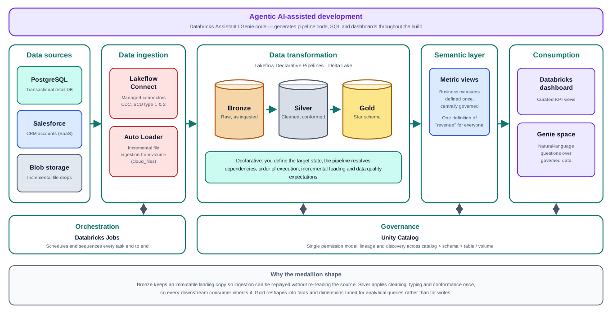
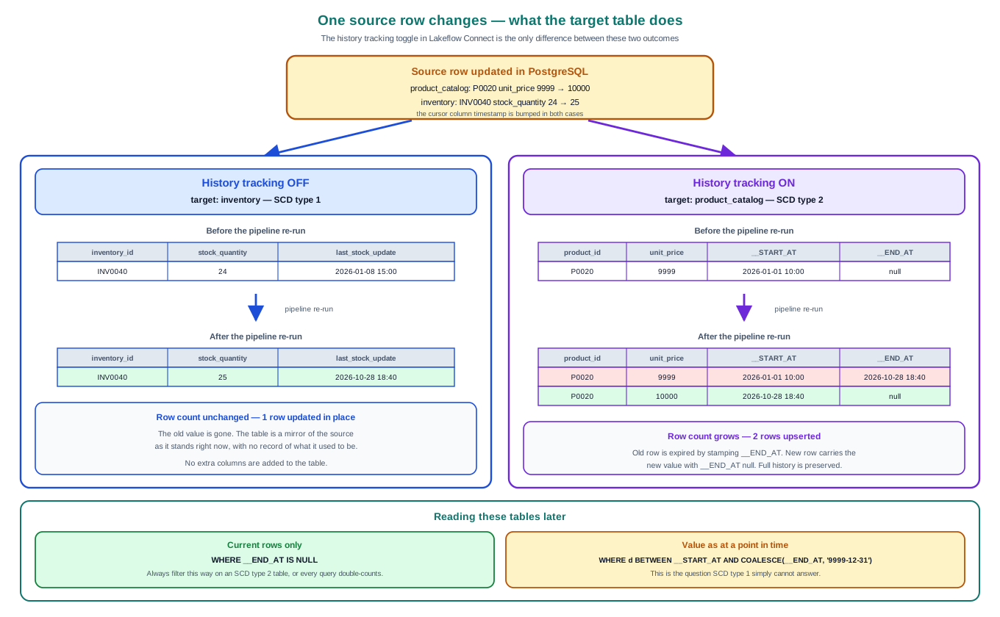
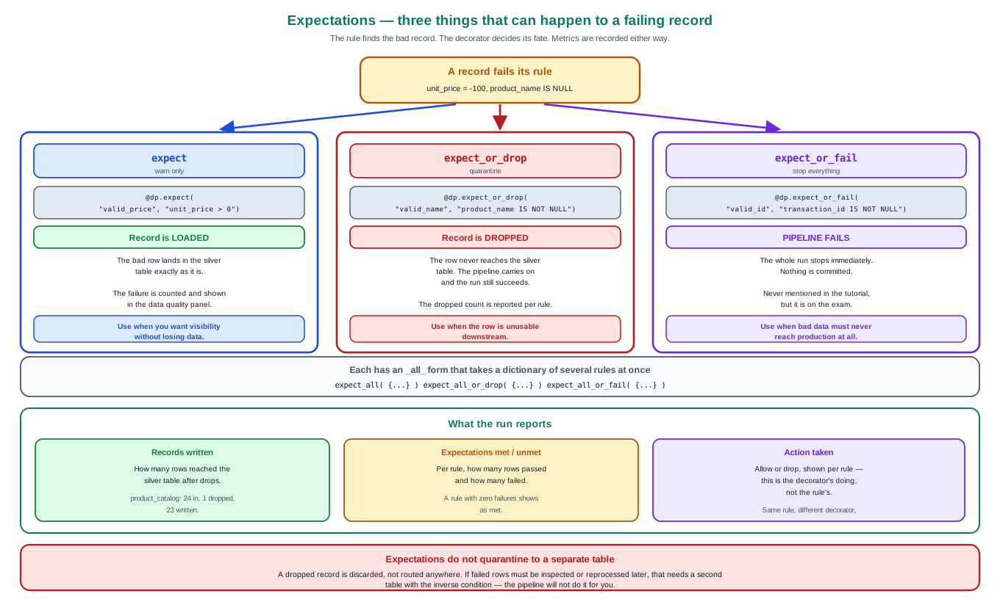
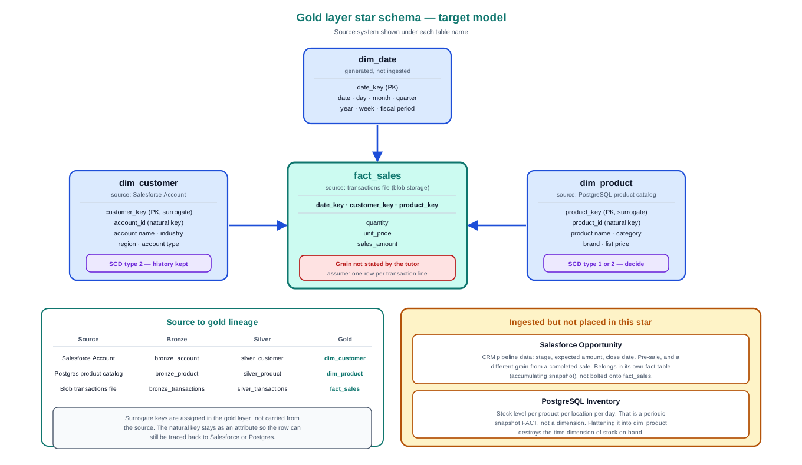
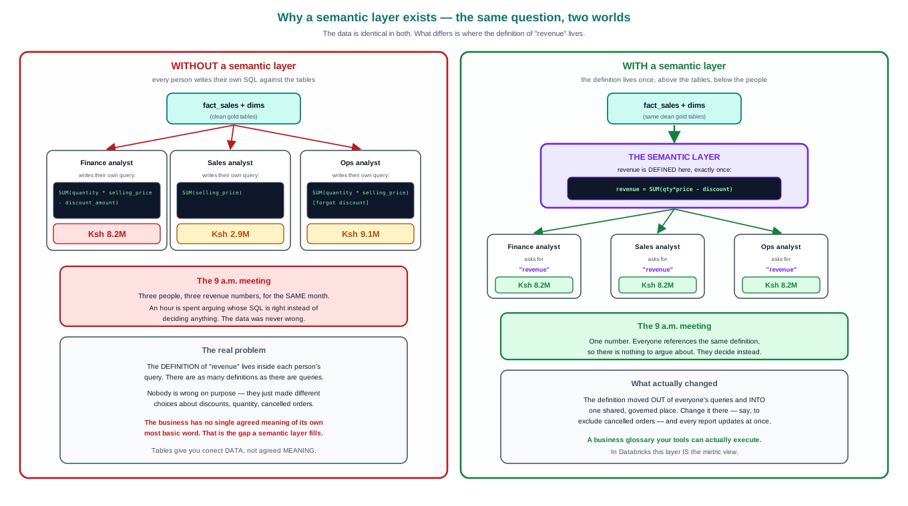
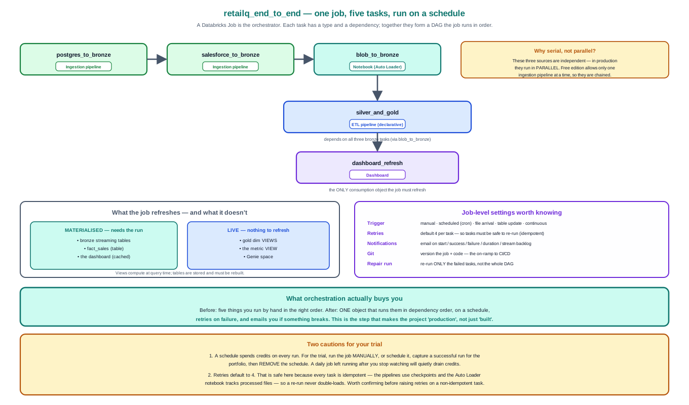
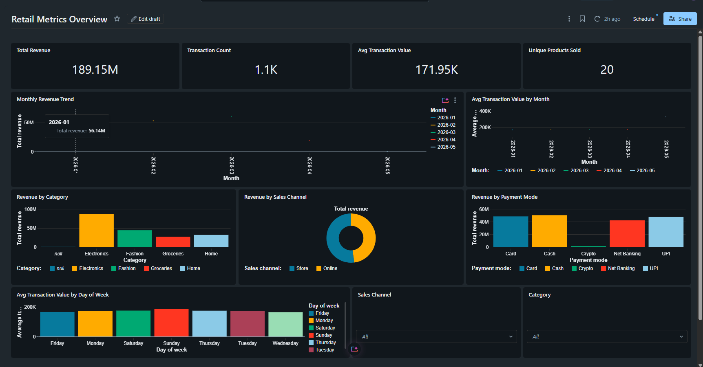
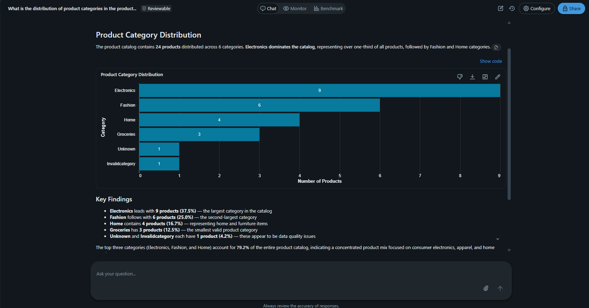

# RetailQ — End-to-End Data Engineering on Databricks

A production-shaped retail analytics platform built on the Databricks Lakehouse: **three heterogeneous sources ingested by three different patterns** into a medallion architecture, modelled as a star schema, governed by a semantic layer, served through a dashboard and natural-language querying, and orchestrated end to end as a single scheduled job — all under Unity Catalog governance.

---

## Overview

The business problem: retail data (transactions, CRM, inventory) spread across disconnected systems, no single source of truth, no self-service analytics. The solution is a governed lakehouse that unifies the sources and exposes trustworthy, reusable metrics.

The three sources are chosen deliberately — they are the three ingestion **archetypes** found in almost any real data platform:

| Source                       | Ingestion pattern                         | Class of problem                                       |
| ---------------------------- | ----------------------------------------- | ------------------------------------------------------ |
| **PostgreSQL** (Neon)        | Lakeflow Connect — managed CDC connector  | Operational database; rows change, need change capture |
| **Salesforce** (Dev Edition) | Lakeflow Connect — managed SaaS connector | API-based SaaS; no DB access, soft deletes             |
| **Cloud storage** (CSV)      | Auto Loader (`cloudFiles`)                | File drops; arrive continuously, must not reprocess    |

---

## What this demonstrates

- **Multi-source ingestion** — managed CDC connectors _and_ code-based incremental file loading (Auto Loader with checkpointing, schema evolution, rescued data)
- **Medallion architecture** — bronze → silver → gold with Lakeflow Declarative Pipelines
- **Data quality as code** — pipeline expectations (`expect` / `expect_or_drop` / `expect_or_fail`), with rules derived from requirements rather than guessed
- **Slowly Changing Dimensions** — SCD type 1 vs type 2, implemented and contrasted
- **Dimensional modelling** — a star schema with a clear grain, fact/dimension separation, degenerate dimensions, a generated calendar
- **Streaming tables vs materialized views** — chosen per table, with the reasoning documented
- **Semantic layer** — a Databricks metric view: business metrics defined once, consumed everywhere
- **Self-service analytics** — a dashboard and a Genie (natural-language) space over governed metrics
- **Orchestration** — a multi-task Databricks Job with a dependency DAG, retries, and scheduling
- **Governance** — Unity Catalog three-level namespace, connections as securables, grant-based handoff

---

## Repository structure

| Folder                                   | Contents                                                                                   |
| ---------------------------------------- | ------------------------------------------------------------------------------------------ |
| [`00-docs/`](00-docs/)                   | Architecture & concept diagrams, the full project summary (`RetailQ-Project-Summary.docx`) |
| [`01-source-setup/`](01-source-setup/)   | PostgreSQL DDL + seed data                                                                 |
| [`02-ingestion/`](02-ingestion/)         | Lakeflow Connect configuration notes, Auto Loader notebook                                 |
| [`03-bronze-silver/`](03-bronze-silver/) | Declarative pipeline transformations, data-quality monitoring SQL                          |
| [`04-gold/`](04-gold/)                   | Star-schema fact build, dimension views, calendar                                          |
| [`05-semantic/`](05-semantic/)           | Metric view definition (YAML) + create script                                              |
| [`06-serving/`](06-serving/)             | Dashboard & Genie notes, screenshots                                                       |
| [`07-orchestration/`](07-orchestration/) | Databricks Job definition                                                                  |

> `tutor-reference/` subfolders hold the original tutorial code verbatim, kept for comparison against the reviewed/revised implementations alongside them.

---

## Pipeline walkthrough

**Ingest → Bronze.** Lakeflow Connect pulls PostgreSQL and Salesforce via managed connectors (no code), using a cursor column for incremental extraction and a history-tracking toggle to produce SCD type 1 or type 2 targets. Files are ingested with Auto Loader.

**Transform → Silver.** A Lakeflow Declarative Pipeline cleans, types, conforms and quality-checks each table. Expectations enforce data quality; the decorator decides whether a failing row is warned, dropped, or fails the run.

**Model → Gold.** A star schema: one `fact_sales` table (a join of transactions and the opportunity bridge) surrounded by `dim_product`, `dim_customer` and a generated `dim_calendar`. Dimensions are virtual views over silver; only the fact is materialised.

**Semantic layer.** A metric view defines each business metric (revenue, quantity, transaction count, …) once, with its aggregation rule and synonyms — so a dashboard, a Genie space and an ad-hoc query all return the same number.

**Orchestrate.** A single Databricks Job runs the whole thing as a dependency DAG, on a schedule, with retries.

---

## Key engineering decisions & trade-offs

Real data engineering is a sequence of judgement calls. The ones made here, stated plainly:

- **Watermark-based ingestion, not log-based CDC.** Simpler and connector-native; the trade-off is that hard deletes in PostgreSQL are not propagated. Accepted and documented.
- **Streaming table vs materialized view, chosen per table.** Append-only file sources and facts stream; anything built on a merge-maintained SCD source is a materialized view. Streaming trusts the past; merges rewrite it.
- **`unit_price` on the dimension, `selling_price` on the fact.** List price describes the product; actual price measures the sale. The gap is the discount, derivable from a join rather than stored twice.
- **Mixed-grain measure designed out at the semantic layer.** Opportunity `amount` sits at a coarser grain than the transaction fact; it is deliberately excluded from the metric view so no one can `SUM` it incorrectly.
- **Data-quality rules derived with the business, not generated by AI.** AI was used to _draft_ rules and code; every rule's action (warn/drop/fail) was a deliberate choice, and every generated line was reviewed before use.

A full decisions-and-trade-offs register is in [`00-docs/RetailQ-Project-Summary.docx`](00-docs/RetailQ-Project-Summary.docx).

---

## Known limitations

- **Customer dimension unpopulated.** The transactions file and the Salesforce Developer-Edition sample opportunities share no matching `opportunity_name`, so the transaction→opportunity→customer bridge join resolves to null and `customer_id` is empty. Cause identified and documented; the fix is to regenerate the transactions data with opportunity names that exist in the Salesforce org. Dashboards and metrics are built around the populated dimensions (product, calendar, and transaction attributes).
- **SCD type 2 consumed as type 1.** History is captured in silver but the gold dimension views expose current versions only. Realising full point-in-time history is a planned extension (surrogate keys).

Planned extensions are listed in [`00-docs/extension-ideas.md`](00-docs/extension-ideas.md).

---

## Results

> Screenshots from the live workspace.

| Dashboard                                          | Job run (DAG)                                  | Genie (natural language)                   |
| -------------------------------------------------- | ---------------------------------------------- | ------------------------------------------ |
|  |  |  |

---

## Build it yourself

All resources are free-tier.

1. **Sources** — a PostgreSQL database (Neon / Supabase / Render), a Salesforce Developer Edition org, and a cloud storage location or Databricks volume.
2. **Databricks** — a workspace (Free Edition, or a trial with credits for the managed connectors). Serverless compute.
3. **Load** — run `01-source-setup/*.sql` against PostgreSQL; ingest via the Lakeflow Connect wizard (`02-ingestion/`) and the Auto Loader notebook.
4. **Transform** — create an ETL pipeline from `03-bronze-silver/` and `04-gold/`.
5. **Serve** — create the metric view (`05-semantic/`), then a dashboard and Genie space (`06-serving/`).
6. **Orchestrate** — build the Job from `07-orchestration/`.

Each folder's notes contain the exact steps and the concepts behind them.

---

## Certification

This project was built alongside preparation for the **Databricks Certified Data Engineer Associate** exam, and exercises most of its blueprint: Unity Catalog, Delta Lake, Auto Loader, Declarative Pipelines (DLT) with expectations, SCD handling, and Jobs orchestration.
